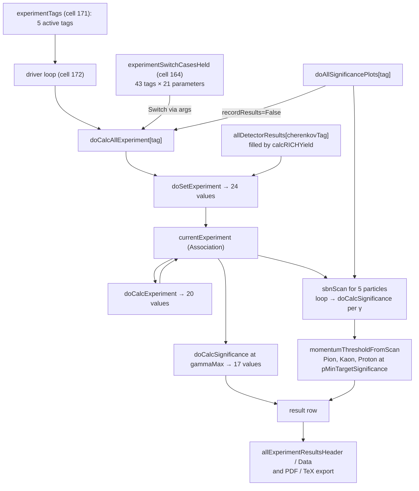

# RICH calculator — code map

> Generated 2026-10-27 by static analysis of `calculator--2026-10-26-fixes.nb` and `src/*.wl`; nothing was evaluated. Names, cell numbers, signatures, result-vector layouts and the dependency tables are computed from the source; the one-line descriptions come from reading the definitions. Cell numbers are positions in the notebook's list of heading, text and input cells and change when the notebook is edited. How to regenerate: §8.

**Basis.** `calculator--2026-10-26-fixes.nb` is the Oct 26 notebook with fixes A1, A2, A3 and B1 (`docs/calculator--2026-10-26-fixes.diff`); the tracked `notebooks/calculator.nb` (Aug 24) is the version before them. It has 759 input cells.

## 1. Where the code lives

`LoadProject.wl` loads the `calculator` case as a chain; each package sees the ones above it. The notebook body then adds everything below `---... CALCULATOR`.

| # | File | Context | Role | Functions / values |
|---|------|---------|------|-------------------:|
| 1 | `src/myNotebookInit.wl` | `myNotebookInit`` | bootstrap, banners, `printD`, load log, docked toolbar, `exportGraphicsToPDF` | 95 |
| 2 | `src/cellStyleDataRules.wl` | — | cell-style rules | 1 |
| 3 | `src/base.wl` | `base`` | general helpers: number formatting (`nf…`), `debugPrint`, table utilities | 86 |
| 4 | `src/statDataAnal.wl` | `statDataAnal`` | statistics helpers (`sumInQuadr`, histograms, error propagation) | 36 |
| 5 | `src/physicsGeneral.wl` | `physicsGeneral`` | relativistic kinematics and Cherenkov relations (β, γ, θC, thresholds, `numRelPho`) | 39 |
| 6 | `src/inputDataForRICH.wl` | `inputDataForRICH`` | sensor and optics input data (PDE and transmission curves, constants) | 136 |
| 7 | `src/RICH.wl` | `rich`` | radiator and yield calculation (`calcRICHYield`, efficiencies, `thisThetaChr`, `allDetectorResults`) | 83 |
| 8 | `src/calculator.wl` | `calculator`` | notebook initialization only (stops before `CALCULATOR BODY`) | 27 |
| 9 | notebook, `CALCULATOR BODY` | `Global`` | the calculator itself (this map) | 1184 |

## 2. Notebook map

| Block (heading) | Cells | What is there | Status |
|---|---|---|---|
| `---... SETUP` | 1–5 | universal bootstrap cell (`RICHNotebookBootstrap`) and explanatory text | active |
| `SOME PRELIMINARY CALCULATIONS` | 6–60 | `calcRICHYield` over the radiators (`doCalcAllRadiators2022`, `doCalcAllRadiatorsUpg2`, then the RICH1 / RICH2 / ALADDIN cells) to fill `allDetectorResults`; 18 of the 37 input cells are non-evaluatable | partly active |
| `INPUT DATA` › basic | 66–80 | pixel and geometry helpers, `fiducialAreaOfTheRing`, `mmToMRad`, `mRadToMm` | active |
| `INPUT DATA` › single photon angular precision … | 84–102 | per-detector tuned symbols `sigmaSnglPhAsymptUpg*`, `numPhoUpg*`, `sigmaChrRngAsymptUpg*`, protected afterwards through `theTunedDetectorSymbols` | active |
| `INPUT DATA` › PDA | 103–114 | reference values (`…Ref`, protected), refractive indices, time bins, γ list (`gammaMax`, `numSteps`, `gammaVal`) | active |
| `INPUT DATA` › general functions | 115–120 | unit helpers (`toPure`, `toMRad`, …), binary-occupancy functions, Poisson and significance checks | active |
| `detector design` › DETECTOR FUNCTIONS | 124–138 | **`doSetExperiment`**, **`doCalcExperiment`**, **`doCalcSignificance`**, `sbnScan`, `loop`, `listOfGammasFor`, **`doAllSignificancePlots`** | active |
| `CALC ALL EXPERIMENTS` › init | 140–151 | output-table helpers (`cleanHeadForOutput`, `showSelectedOutputEntries…`, `whichExperiment…`) | active |
| `CALC ALL EXPERIMENTS` › NEW TO IMPLEMENT AND CHECK | 152–224 | **`experimentSwitchCasesHeld`** (one parameter list per experiment tag), **`doCalcAllExperiment`**, `checkedStageResult`, `momentumThresholdFromScan`, `experimentTags`, the driver loop, summary tables; the keyed-configuration refactor (`doSetExperimentNamed`, `allExpData`, `validateDoSetExperimentConfig`) is present but non-evaluatable | active, refactor in progress |
| `miscellanea`, `END` | 225–239 | fixed-momentum difference tables and small utilities | active |
| `UNFINISHED - WORK IN PROGRESS` | 240–908 | CalAliMon, ray tracing, error analysis, **CHROMATICA** (defines the chromatic σ model that `doCalcSignificance` uses), 2D pixels, dark counts, group velocity, RICH resolution, dispersion studies | exploratory, but see §6 |

## 3. Runtime pipeline



`doCalcAllExperiment` is the entry point and must be run first for an experiment: it creates the `currentExperiment` context that the other functions take (fix B1) and sets the legacy `this…` globals. `doAllSignificancePlots` re-runs it with `recordResults=False`, then scans and plots.

Active experiment tags (cell 171): `R1L-upg1`, `R1H-upg1`, `R2L-upg1`, `R2H-upg1`, `R1L-upg2`.
Every active tag has a case in the table, which holds 43 tags.

## 4. The five main functions

### `doCalcAllExperiment`

cell 168 (init › NEW TO IMPLEMENT AND CHECK) — orchestrator for one experiment tag: select the parameters → `doSetExperiment` → `doCalcExperiment` → `doCalcSignificance` → momentum scans → one result row.

```wl
doCalcAllExperiment[
  theTempTag_,
  theDebugFlag_:False,
  recordResults_:True
]
```

**Output.** appends a result row to `allExperimentResultsHeader/Data` (unless `recordResults=False`) and exports PDF and TeX; sets the `this…` globals and `currentExperiment`.

**Helpers called** — `checkedStageResult`, `debugPrint`, `debugPrintD`, `doCalcExperiment`, `doCalcSignificance`, `doSetExperiment`, `dropFirst`, `miniBanner`, `momentumThresholdFromScan`, `sbnScan`, `toGeVc`

**Global values read** — `allExperimentResultsData`, `allExperimentResultsHeader`, `args`, `gammaMax`, `headerDoCalcExperiment`, `headerDoCalcSignificance`, `headerDoSetExperiment`, `idMom`, `idSBN5`, `pMinTargetSignificance`, `theListOfGammas`, `theParts`, `thisEffFocalLength`, `thisRefrIndex`, `thisTimeStamp`

**Globals written** — `allExperimentResultsData`, `allExperimentResultsHeader`, `currentExperiment`, `sbnScanResults`, `theTag`, `thisBandTotalRadiusChrAsympt`, `thisBckCntInRingAreaAsymptInGateTime`, `thisDNICntInRingAreaAsymptInGateTime`, `thisEff`, `thisEffFocalLength`, `thisIntensityDarkCntsNoise`, `thisIntensityPhysicalBckgr`, `thisMRadToMm`, `thisMmToMRad`, `thisNumChrPho`, `thisNumChrPhoRaw`, `thisNumChrPhoSignal`, `thisNumPixEquivInRingArea`, `thisNumPixEquivOnRingCircumference`, `thisPDAGeoLong`, `thisPDAGeoShrt`, `thisPixAngSize`, `thisPixLinSize`, `thisRadiusChrAsympt`, `thisRadiusChrInPixelsAsympt`, `thisRefrIndex`, `thisScaleFactorBandRadius`, `thisScaleFactorRejectBackFromTimingInReco`, `thisSearchRingAreaAsympt`, `thisSigmaChrRngAsympt`, `thisSigmaSnglPhAsympt`, `thisThetaChrAsympt`, `thisTimeBin`

### `doSetExperiment`

cell 126 (DETECTOR FUNCTIONS › doSetExperiment) — turns the dimension-full experiment inputs (focal length, pixel size, luminosity and time-bin factors, reference intensities, σ and photon-number inputs, PDA geometry) into the derived experiment constants; looks up `allDetectorResults[cherenkovTag]` for the radiator.

```wl
doSetExperiment[
  debug_:False,
  theFocLen_,
  theFocLenRef_,
  thePixLinSiz_,
  theFctLum_,
  theTimBin_,
  theFctDNI_,
  theFctOthers_,
  theIntDarkNoisRef_,
  theIntPhysBackRef_,
  theRfrInd_,
  theSigmaSnglPhAsympt_,
  theNumPhoAsympt_,
  theSigmaChrRngAsympt_,
  theScaleFactorRejectBackFromTimingInReco_:toPure[1],
  thePDAGeoLong_:{0,0},
  thePDAGeoShrt_:{0,0},
  theScaleFactorBandRadius_:2.5,
  sensor_:"n/a",
  cherenkovTag_:"",
  detectorTag_:""
]
```

**Output.** returns a 24-element list; also fills `resultsDoSetExperiment` (header `headerDoSetExperiment`).

**Result vector** (`doCalcAllExperiment` reads these by position)

| # | value | # | value |
|--:|---|--:|---|
| 1 | `effFocalLength` | 13 | `theScaleFactorRejectBackFromTimingInReco` |
| 2 | `pixLinSize` | 14 | `thePDAGeoLong` |
| 3 | `pixAngSize` | 15 | `thePDAGeoShrt` |
| 4 | `intensityPhysBackRef` | 16 | `theScaleFactorBandRadius` |
| 5 | `timeBin` | 17 | `scaleFactDNI` |
| 6 | `scaleFactOthers` | 18 | `theMmToMRad` |
| 7 | `intensityDarkNois` | 19 | `theMRadToMm` |
| 8 | `thetaChrAsympt` | 20 | `gammaThreshold` |
| 9 | `sigmaSnglPhAsympt` | 21 | `cherenkovTag` |
| 10 | `sigmaChrRngAsympt` | 22 | `xyzExamplePlaceHolderVariable` |
| 11 | `numPhoRawAsymptLocal` | 23 | `theIntDarkNoisRef` |
| 12 | `radRefractiveIndex` | 24 | `theIntPhysBackRef` |

**Helpers called** — `debugPrint`, `gamThr`, `mRadToMm`, `mmToMRad`, `pixelGeometricalAcceptanceRelativeToDefault`, `sumInQuadr`, `toIntensity`, `toMMet`, `toMRad`, `toNanS`, `toNumPhotons`, `toPure`

**Global values read** — `headerDoSetExperiment`

**Globals written** — `resultsDoSetExperiment`

### `doCalcExperiment`

cell 128 (DETECTOR FUNCTIONS › doCalcExperiment) — asymptotic (γ→∞) photon, background and dark-noise counts and occupancies in the pixel, ring and time gate; ring radius and area; maximum separating momenta.

```wl
doCalcExperiment[
  debug_:False,
  theNumPhoRawAsympt_,
  theTimeBin_,
  thetaChrAsympt_,
  thePixLinSiz_,
  theScaleFactorBandRadius_,
  theFocLen_,
  theSigmaSnglPhAsympt_,
  theIntPhysBack_,
  theIntDarkNois_,
  thePixAngSize_,
  theScaleFactorRejectBackFromTimingInReco_,
  thePDAGeoLong_,
  thePDAGeoShrt_,
  theExperiment_Association
]
```

**Output.** returns a 20-element list; also fills `resultsDoCalcExperiment` (header `headerDoCalcExperiment`).

**Result vector** (`doCalcAllExperiment` reads these by position)

| # | value | # | value |
|--:|---|--:|---|
| 1 | `theNumChrPhoInGaussianBandAsympt` | 11 | `bandTotalRadiusChrAsympt` |
| 2 | `totOccupInPixelInGateTime` | 12 | `scaleFactTimeBin` |
| 3 | `bckTrueCntsInPixelInGateTimeEquiv` | 13 | `theRingAreaAsympt` |
| 4 | `dniTrueCntsInPixelInGateTimeUnifo` | 14 | `scaleFactRejectBackFromTimingInReco` |
| 5 | `bckTrueCntsInPixelInBCOTime` | 15 | `bckOccupInPixelInGateTimeEquiv` |
| 6 | `dniTrueCntsInPixelInBCOTime` | 16 | `dniOccupInPixelInGateTimeUnifo` |
| 7 | `bckTrueCntsInRingAreaAsymptInGateTimeEquiv` | 17 | `areaPDAFromNominalGeoAccept` |
| 8 | `dniTrueCntsInRingAreaAsymptInGateTimeUnifo` | 18 | `maxIdealNumChannels` |
| 9 | `radiusChrAsympt` | 19 | `bckOccupInPixelInBCOTime` |
| 10 | `radiusChrInPixelsAsympt` | 20 | `dniOccupInPixelInBCOTime` |

**Helpers called** — `calcBinaryOccupancyFromTrueToApparent`, `createMRad`, `debugPrint`, `fiducialAreaOfTheRing`, `sumInQuadr`, `toCounts`, `toNumPixels`, `toPure`

**Global values read** — `δMassesList`, `μMassesList`, `headerDoCalcExperiment`, `theTimeBinBCORef`

**Globals written** — `resultsDoCalcExperiment`

### `doCalcSignificance`

cell 131 (DETECTOR FUNCTIONS › doCalcSignificance) — significance of the ring at one γ: signal, ring area, background and dark counts versus momentum, and six significance definitions `sbn1…sbn6` (names in `ssbnName`).

```wl
doCalcSignificance[
  theExperiment_Association,
  debug_:False,
  theGamma_:gammaMax,
  modeFlag_:""
]
```

**Output.** returns a 17-element list; also fills `resultsDoCalcSignificance`. Entries 15–17 (`pMin…`) are placeholders that `doCalcAllExperiment` fills afterwards.

**Result vector** (`doCalcAllExperiment` reads these by position)

| # | value | # | value |
|--:|---|--:|---|
| 1 | `theGamma` | 10 | `sbn5` |
| 2 | `toNumPhotons@sgnlVersusMomentum[theGamma]` | 11 | `sbn6` |
| 3 | `ringAreaVersusMomentum[theGamma]` | 12 | `modeFlag` |
| 4 | `totalBckgInRingAreaInGateTimeVersusMomentum[theGamma]` | 13 | `theNumPixEquivInRingArea` |
| 5 | `totalDarkInRingAreaInGateTimeVersusMomentum[theGamma]` | 14 | `theNumPixEquivOnRingCircumference` |
| 6 | `sbn1` | 15 | `pMinPion5` |
| 7 | `sbn2` | 16 | `pMinKaon5` |
| 8 | `sbn3` | 17 | `pMinProt5` |
| 9 | `sbn4` | | |

**Helpers called** — `bigBanner`, `fiducialAreaOfTheRing`, `nf`, `printD`, `sigmaTotSnglPhEvolutionWithGammaRatio`, `thisNumRelChr`, `thisThetaChr`, `toCounts`, `toGeVc`, `toNumPhotons`, `toNumPixels`, `toPure`

**Global values read** — `headerDoCalcSignificance`

**Globals written** — `debugPrintEnabledFlag`, `resultsDoCalcSignificance`

### `doAllSignificancePlots`

cell 135 (DETECTOR FUNCTIONS › doCalcSignificance) — significance-versus-momentum plot for π, K, p with the momentum thresholds marked for the chosen target; defaults to `pMinTargetSignificance` and the `sbn5` column.

```wl
doAllSignificancePlots[
  tag_,
  targetSignificance_:Automatic,
  idSBN_:idSBN5
]
```

**Output.** sets `sbnScanResults`, `sbnScanResults1`, `momentumThresholdsHadrons` and `plot`; exports the plot with `exportGraphicsToPDF`.

**Helpers called** — `doCalcAllExperiment`, `exportGraphicsToPDF`, `momentumThresholdFromScan`, `nf`, `sbnScan`

**Global values read** — `idMom`, `pMinTargetSignificance`, `plot`, `sbns`, `theParts`

**Globals written** — `momentumThresholdsHadrons`, `plot`, `sbnScanResults`, `sbnScanResults1`

## 5. Helper index

Helpers reached from the main functions (call depth up to three, not following calls into the other main functions). Used by: A = `doCalcAllExperiment`, S = `doSetExperiment`, E = `doCalcExperiment`, G = `doCalcSignificance`, P = `doAllSignificancePlots`; a capital letter means the main function calls the helper directly, a lower-case letter that it reaches it only through other helpers.

**Units and conversions**

| Helper | Used by | Defined in | What it does |
|---|---|---|---|
| `toPure` | SEG | cell 116 | strip units (`QuantityMagnitude`) |
| `toMRad` | Se | cell 116 | convert to milliradians |
| `toNanS` | S | cell 116 | convert to nanoseconds |
| `toMMet` | S | cell 116 | convert to millimetres |
| `toNumPixels` | EG | cell 116 | tag a number as pixels (`IndependentUnit["pix"]`) |
| `toNumPhotons` | SG | cell 116 | tag a number as photons (`IndependentUnit["pho"]`) |
| `toCounts` | EG | cell 116 | tag a number as counts (`IndependentUnit["cnts"]`) |
| `toIntensity` | S | cell 116 | convert a Quantity to MHz/mm² |
| `toGeVc` | AG | cell 116 | tag a number as GeV/c |
| `createMRad` | E | cell 116 | build a milliradian Quantity from a number |
| `mmToMRad` | S | cell 80 (+1 more) | mrad per mm at the effective focal length (default `thisEffFocalLength`) |
| `mRadToMm` | S | cell 80 | mm per mrad at the effective focal length |

**Detector geometry and occupancy**

| Helper | Used by | Defined in | What it does |
|---|---|---|---|
| `pixelGeometricalAcceptanceRelativeToDefault` | S | cell 72 | association: pixel geometric-acceptance size → factor relative to the default pixel |
| `fiducialAreaOfTheRing` | EG | cell 73 | annulus area from radius and radial width `[r, δr, α:1]`; the live definition sits inside a `Block`, an older commented copy is in the same cell |
| `calcBinaryOccupancyFromTrueToApparent` | E | cell 119 | mean true counts → apparent binary occupancy, `1-Exp[-x]` |

**Cherenkov physics (`physicsGeneral.wl`, `RICH.wl`)**

| Helper | Used by | Defined in | What it does |
|---|---|---|---|
| `beta` | agp | `src/physicsGeneral.wl:116`; also defined in 3 notebook cells | β from γ |
| `gamThr` | S | `src/physicsGeneral.wl:181` | γ at Cherenkov threshold for index n |
| `gammaCherenkovThreshold` | s | `src/physicsGeneral.wl:174` | γ at Cherenkov threshold for index n |
| `momentumFromMassAndBeta` | ap | `src/physicsGeneral.wl:124`; also defined in 1 notebook cell | p = m·β·γ |
| `numRelPho` | g | `src/physicsGeneral.wl:186` | photon yield relative to its n-dependent maximum, `sin²θ / sin²θmax` |
| `thetaChr` | g | `src/physicsGeneral.wl:161`; also defined in 2 notebook cells | Cherenkov angle `[β, n]` |
| `thisThetaChr` | G | `src/RICH.wl:2190` | Cherenkov angle in mrad for `[γ, n:thisRefrIndex]` |
| `thisNumRelChr` | G | `src/RICH.wl:2191` | relative photon yield for `[γ, n:thisRefrIndex]` |

**Significance scan and thresholds**

| Helper | Used by | Defined in | What it does |
|---|---|---|---|
| `sbnScan` | AP | cell 133 | for one particle: significance table over the γ list (`listOfGammasFor`), one row per γ from `loop` |
| `loop` | ap | cell 138 | one scan point: `doCalcSignificance[experiment, False, γ]` |
| `listOfGammasFor` | ap | cell 133 | γ list for an explicit refractive index, last entry `gammaMax` |
| `theListOfGammas` | A | cell 114 | same γ list from the global `thisRefrIndex` (legacy form) |
| `momentumThresholdFromScan` | AP | cell 167 | momentum at which a significance column reaches a target; `Failure[…]` on bad or non-monotonic scans |
| `sigmaTotSnglPhEvolutionWithGammaRatio` | G | cell 659 | growth of the total single-photon σ with γ relative to γ=9999 (chromatic model) |
| `sigmaTotSnglPhEvolutionWithGamma` | g | cell 659 | total single-photon σ versus γ (needs the fitted chromatic model) |
| `chromaEvolutionWithGammaRatio` | g | cell 659 | chromatic σ(γ)/σ(γmax) from the fitted model |

**Stage checking**

| Helper | Used by | Defined in | What it does |
|---|---|---|---|
| `checkedStageResult` | A | cell 166 | wrap one stage: abort, non-list, wrong length or non-finite values become `Failure[…]` |
| `finiteRealQ` | ap | cell 167 | numeric, finite and real |

**General utilities (`base.wl`, `statDataAnal.wl`, `myNotebookInit.wl`, `RICH.wl`)**

| Helper | Used by | Defined in | What it does |
|---|---|---|---|
| `sumInQuadr` | SEg | `src/statDataAnal.wl:190`; also defined in 1 notebook cell | square root of the sum of squares |
| `nf` | GP | `src/base.wl:653` | NumberForm shortcut `[x, sp, dg, exp]` |
| `dropFirst` | A | `src/base.wl:733` | `Drop[x,1]` |
| `debugPrint` | ASE | `src/base.wl:379`; also in `src/RICH.wl:335` | print only when the debug flag is on |
| `debugPrintD` | A | `src/RICH.wl:344`; also in `src/calculator.wl:375` | debug print with the held expression (`RICH.wl` copy) |
| `printD` | aG | `src/myNotebookInit.wl:1584` | HoldAll print of an expression and its value |
| `showIt` | ag | `src/myNotebookInit.wl:1583` | HoldAll print of an expression and its value |
| `bigBanner` | G | `src/myNotebookInit.wl:802` | framed banner message |
| `miniBanner` | A | `src/myNotebookInit.wl:818` | one-line banner message |
| `bannerLine` | ag | `src/myNotebookInit.wl:786` | repeated-character separator line |
| `exportGraphicsToPDF` | P | `src/myNotebookInit.wl:328` | export graphics to the project output folder (mode: Button / Immediate / Disabled) |
| `performGraphicsPDFExport` | p | `src/myNotebookInit.wl:318` | does the PDF export for `exportGraphicsToPDF` |
| `configuredProjectDirectory` | p | `src/myNotebookInit.wl:288` | resolved project output/backup directory |

## 6. Shared state and out-of-place dependencies

From the dependency scan, not from running the notebook.

**Reached from the main functions but defined only in the `UNFINISHED` part** (names the main functions assign themselves are left out)

| Name | Cell | Section |
|---|---|---|
| `chromaEvolutionWithGammaRatio` | 659 | CHROMATICA › Plots |
| `sigmaTotSnglPhEvolutionWithGamma` | 659 | CHROMATICA › Plots |

**Shared parameters defined in more than one cell** (a later evaluation replaces the earlier value)

| Name | Definitions |
|---|---|
| `gammaMax` | cell 114 `gammaMax=9999999;`; cell 524 `gammaMax=1000000;` |
| `numSteps` | cell 114 `numSteps=37;`; cell 645 `numSteps=13;`; cell 646 `numSteps=13;`; cell 648 `numSteps=53;` |
| `thisRefrIndex` | cell 80 `thisRefrIndex=-1;`; cell 113 `thisRefrIndex:=theRefrIndexRefVal;` |
| `mmToMRad` | cell 80 `mmToMRad[focLen_:thisEffFocalLength]:=toMRa…`; cell 716 `mmToMRad:=(10^-3/focLen)*1000/.data;` |

**Package symbols that notebook cells also define** (`physicsGeneral.wl` protects them)

- `beta`: cells 340, 812, 834
- `thetaChr`: cells 841, 865
- `momentumFromMassAndBeta`: cells 865

**Legacy `this…` globals set by `doCalcAllExperiment`** (kept for interactive cells; the pipeline passes `currentExperiment`): `thisBandTotalRadiusChrAsympt`, `thisBckCntInRingAreaAsymptInGateTime`, `thisDNICntInRingAreaAsymptInGateTime`, `thisEff`, `thisEffFocalLength`, `thisIntensityDarkCntsNoise`, `thisIntensityPhysicalBckgr`, `thisMRadToMm`, `thisMmToMRad`, `thisNumChrPho`, `thisNumChrPhoRaw`, `thisNumChrPhoSignal`, `thisNumPixEquivInRingArea`, `thisNumPixEquivOnRingCircumference`, `thisPDAGeoLong`, `thisPDAGeoShrt`, `thisPixAngSize`, `thisPixLinSize`, `thisRadiusChrAsympt`, `thisRadiusChrInPixelsAsympt`, `thisRefrIndex`, `thisScaleFactorBandRadius`, `thisScaleFactorRejectBackFromTimingInReco`, `thisSearchRingAreaAsympt`, `thisSigmaChrRngAsympt`, `thisSigmaSnglPhAsympt`, `thisThetaChrAsympt`, `thisTimeBin`.

**Where `allDetectorResults[tag]` is filled** (read by `doSetExperiment`): `calcRICHYield` (RICH.wl:828).

## 7. Observations from the static pass

Not run and not fixed: candidates to check, most useful first.

1. **`beta` is overwritten by an exploratory cell.** Cell 340 runs `Unprotect[beta]` and assigns a number to `beta` (assignments in cells 340, 812, 834). Once that cell is evaluated, `beta[γ]` no longer evaluates as the function of `physicsGeneral.wl` (a value on the symbol replaces the head), so `thisThetaChr`, `thisNumRelChr` and therefore `doCalcSignificance`, `sbnScan` and `doAllSignificancePlots` give wrong results until `beta =.` is run or the kernel is restarted and the packages are reloaded.
2. **Order-dependent significance.** `doCalcSignificance` uses `sigmaTotSnglPhEvolutionWithGammaRatio`, which is defined with the chromatic model in the CHROMATICA part (cell 659). Cell 136 sets the ratio to 1 (γ→∞ only) and prints a warning when it is undefined, so the results depend on whether the CHROMATICA cell was evaluated first.
3. **Parameters redefined by other cells.** `gammaMax` in cells 114, 524; `numSteps` in cells 114, 645, 646, 648; `thisRefrIndex` in cells 80, 113; `mmToMRad` in cells 80, 716. Evaluating the later ones changes the γ list, the default scan point or the conversion functions used by the main code (`mmToMRad` is a function in one cell and a value in another).
4. **Hard-coded export path.** `doCalcAllExperiment` writes `C:\TEMP\res-<tag>-<timestamp>.pdf` and `.tex` when `recordResults` is true; the README describes `RICHOutputPath[…]` for portable paths.
5. **Positional coupling.** `doCalcAllExperiment` reads `resPara`, `resCalc` and `resSign` by index; `checkedStageResult` verifies only the lengths (24, 20, 17), not what each position means. `thisEff := resPara[[21]]` is the `cherenkovTag` string, and `thisEff` is not read anywhere else.
6. **Refactor not yet active.** The keyed configuration (`doSetExperimentNamed`, `validateDoSetExperimentConfig`, `allExpData`; 10 cells) is non-evaluatable. The production path still uses the positional 21-parameter lists of `experimentSwitchCasesHeld` (41925 characters of source).
7. **Other protected package symbols.** Notebook cells also define `thetaChr` (cells 841, 865), `momentumFromMassAndBeta` (cell 865). While `physicsGeneral.wl` protects these symbols the definitions are rejected; they would replace the functions used by the main code only after an `Unprotect`.

## 8. Regenerate

```
python3 tools/calculator-map/nbextract.py notebooks/<notebook>.nb  work/cells.json
python3 tools/calculator-map/build_index.py . work/cells.json work/defs.json
python3 tools/calculator-map/build_map.py   . work/cells.json work/defs.json docs/CALCULATOR_MAP.md <notebook>.nb
```

Limits: the parser is a lightweight tokenizer, not the Wolfram parser. Definitions created by `Set` inside loops or `ToExpression`, and names built at run time, are not seen, so search for a name reported as missing before trusting it.
